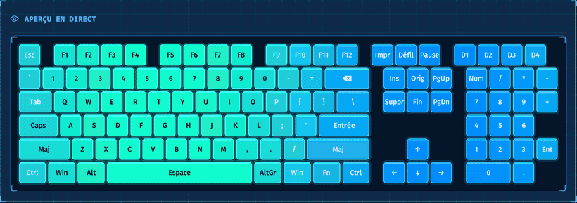
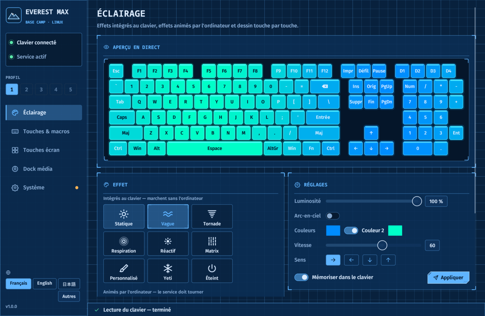
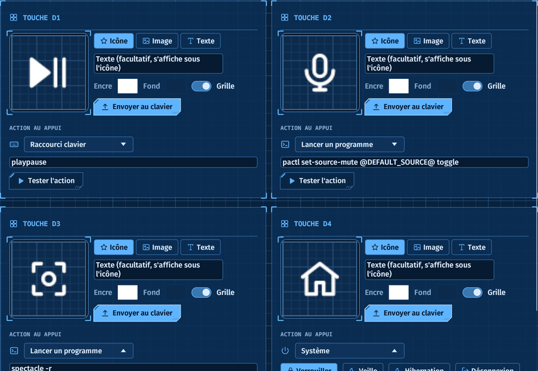

<div align="center">


# Everest Max Linux

**Le Base Camp qui manquait sur Linux pour le clavier Mountain Everest Max.**

[English](README.md) · **Français** · [日本語](README.ja.md)

[](LICENSE)

</div>

---

Tu as un Everest Max, tu es passé sous Linux, et tu t'es rendu compte que Base Camp n'existe que sous Windows ? Pareil. Du coup j'ai décortiqué comment Base Camp parle au clavier, et j'ai refait une appli native Linux, en Rust, qui fait la même chose… et même un peu plus.

> Projet perso, **non officiel**, sans aucun lien avec Mountain. Ça marche chez moi sur un vrai Everest Max, mais utilise-le en connaissance de cause.



## Ce que ça sait faire

- **Éclairage** : les 9 effets intégrés au clavier (Vague, Tornade, Respiration, Réactif, Matrix, Yeti…) avec couleurs, vitesse, sens et arc-en-ciel. Aperçu animé en direct avant d'envoyer.
- **12 effets en plus, animés par le PC** : Aurore, Feu, Pluie, Étoiles, Dégradé, Spectre audio, Pulsation audio, et des jauges CPU / GPU / RAM / internet directement sur les touches.
- **Dessin touche par touche** : tu peins ton clavier à la souris, en cliquant ou en glissant.
- **Touches & macros** : remapper n'importe quelle touche, la désactiver, lui mettre un raccourci, une fonction multimédia / souris / profil, ou une macro. Tout est stocké dans le clavier, donc ça marche même sans l'appli.
- **Les 4 touches écran du pavé (D1–D4)** : une icône (76 fournies), ton image ou du texte, plus une action au clic : lancer un programme, ouvrir un site, jouer un son sur la sortie de ton choix (avec réglage du volume jusqu'à 150 %), raccourci, macro, verrouiller, éteindre…
- **Dock média** (le module avec l'écran rond) : ton image en écran de veille, l'heure, le volume du système, et les infos PC (CPU, GPU, disque, internet, RAM, frappes par minute) qui s'affichent enfin.
- **MacroPad et DisplayPad** : une action sur chacune des 12 touches, l'éclairage du MacroPad (effets intégrés et couleur par touche), et une icône, image ou texte sur chaque touche du DisplayPad. Pas encore testé sur du vrai matériel (je n'ai aucun des deux), donc les retours sont les bienvenus.
- **Profils** : activer / désactiver les profils du clavier (clic droit sur le numéro).
- **Installation guidée** : au premier lancement, l'appli vérifie ce qui manque (règle udev, service, raccourci dans le menu…) et s'en occupe. Elle te prévient aussi quand une mise à jour est à installer.
- **3 langues** : français, anglais, japonais.

## Les captures

### Éclairage



Tu choisis un effet, tu règles, tu regardes l'aperçu, et tu cliques sur **Appliquer**. Avec « Mémoriser dans le clavier », il garde l'effet même débranché.

Pour peindre touche par touche, prends l'effet **Personnalisé** :


Les effets « animés par l'ordinateur » sont calculés par le service en arrière-plan (environ 30 images/s). Pour le spectre audio, tu peux choisir d'écouter tous les sons, une sortie précise, ou ton micro.

### Touches & macros


Clique une touche, choisis ce qu'elle fait, **Envoyer cette touche**. Dans l'exemple : Verr. Maj fait un Ctrl+C, et Défil met la musique en pause.

### Touches écran


Choisis une icône dans la bibliothèque, une image à toi, ou écris du texte (le japonais marche aussi), puis **Envoyer au clavier**. Côté action, quand tu en mets une, l'appli coupe automatiquement la frappe d'origine de la touche pour que ça ne tape pas F13 en même temps.



Les 76 icônes existent aussi en PNG 72×72 dans [`rust/assets/keys`](rust/assets/keys) si tu veux les utiliser ailleurs :


### Dock média


Le dock n'affiche ton image que comme **écran de veille** : choisis le type « Image », règle le délai, et applique. Pour les infos PC, c'est le service qui envoie les valeurs chaque seconde (sinon tout reste à 0). Pour internet, 100 % = la vitesse de ta carte réseau, ou le plafond que tu choisis.

### Système


L'état de l'installation, le service, les profils, et la possibilité d'« apprendre » n'importe quelle autre touche pour lui donner une action PC.

## Installation

Il te faut Rust (`cargo`), et normalement c'est déjà là sur la plupart des distribs : PipeWire ou PulseAudio (`pactl`, `parec`, `paplay`), `fontconfig`, `zenity` ou `kdialog` pour choisir les fichiers, `pkexec` et systemd. Pour le japonais, une police CJK comme Noto Sans CJK.

```sh
git clone https://github.com/AnnoyedDev/everest-max-linux
cd everest-max-linux/rust
cargo build --release
./target/release/everest
```

Au premier lancement, clique sur **Tout configurer**. Le mot de passe admin est demandé une seule fois (pour la règle udev qui donne accès au clavier). Après ça, l'appli est dans ton menu sous **Everest Base Camp**, et le service démarre tout seul à la connexion.

### En ligne de commande

```
everest                  ouvre l'appli
everest setup            vérifie et répare l'installation
everest version          affiche la version
everest clock            met le dock à l'heure
everest image d1 lock    met l'icône « lock » sur D1 (marche aussi avec un fichier ou du texte)
everest export-icons     exporte les icônes PNG
```

## Comment ça marche

Base Camp passe par une DLL (`SDKDLL.dll`) qui envoie des paquets de 64 octets au clavier. J'ai tout désassemblé, noté chaque commande, et vérifié sur le vrai clavier. Tout est expliqué dans [PROTOCOL.md](PROTOCOL.md).

## Désinstaller

```sh
systemctl --user disable --now everest-basecamp
rm ~/.config/systemd/user/everest-basecamp.service ~/.local/bin/everest ~/.local/share/applications/everest-basecamp.desktop
sudo rm /etc/udev/rules.d/70-mountain-everest.rules /etc/modules-load.d/everest-uinput.conf
sudo udevadm control --reload && sudo udevadm trigger
```

Tes réglages sont dans `~/.config/everest-basecamp/`.

## Envie d'aider ?

- **Traductions** : tout est dans [`rust/data/i18n.tsv`](rust/data/i18n.tsv), une ligne par texte (français, anglais, japonais). Ajoute une colonne, ou corrige ce qui sonne faux.
- **Bugs / idées** : ouvre une issue, avec ce que tu as fait et ce qui s'est passé.

Pas encore fait : la mise à jour du firmware (trop risqué à l'aveugle) et la couche Fn (le clavier n'a pas de commande pour ça).

## Licence

[MIT](LICENSE) : tu peux tout réutiliser, modifier, revendre ou intégrer dans ton projet, même commercial. La seule condition : garder la mention « Copyright (c) 2026 AnnoyedDev » et le texte de la licence. Ça vaut pour le code, les icônes et les images.
