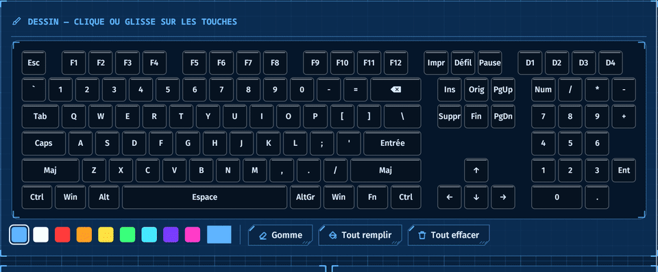
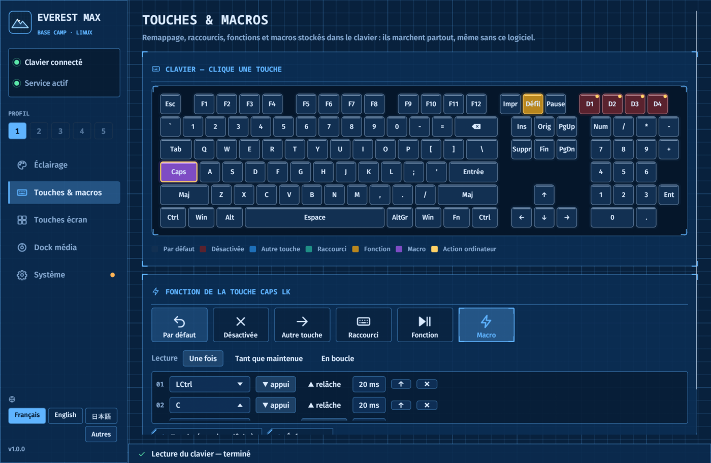
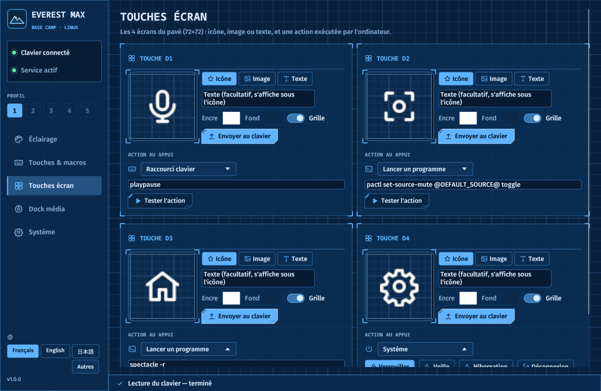
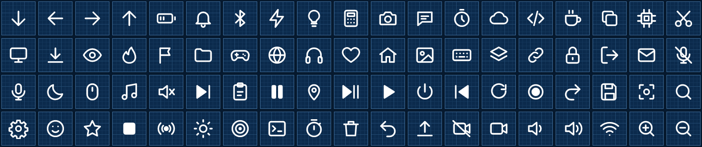
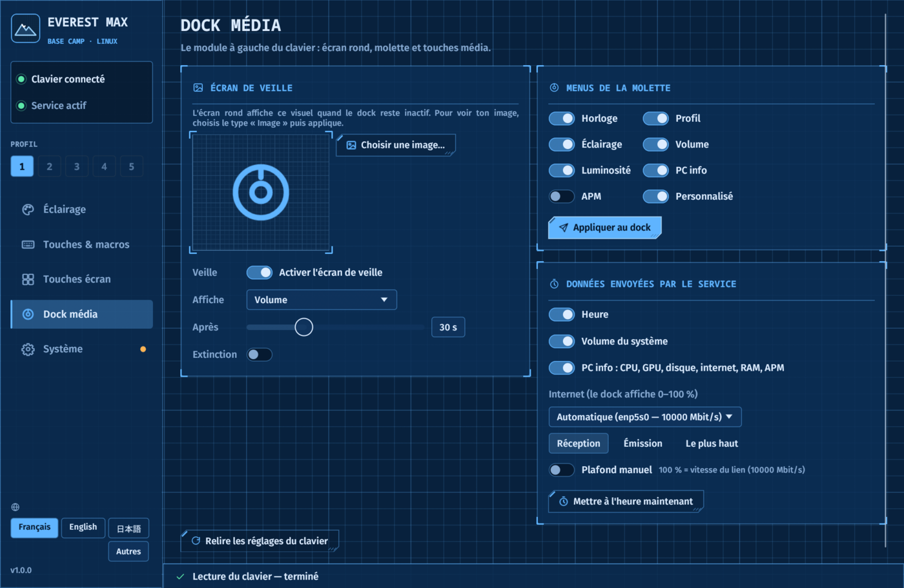
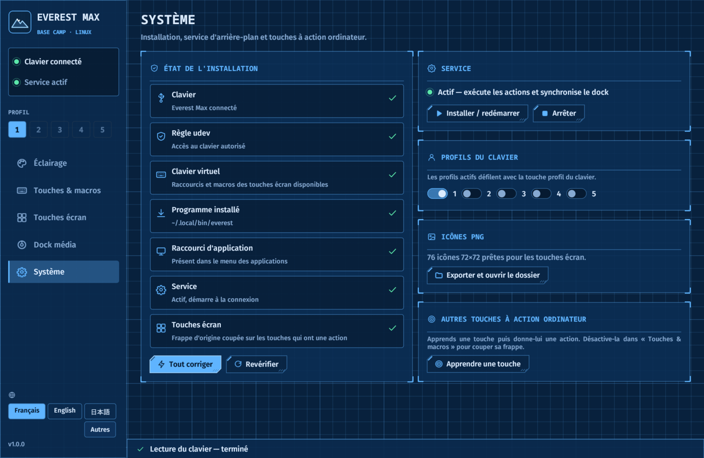

<div align="center">


# Everest Max Linux

Le Base Camp du clavier Mountain Everest Max, refait pour Linux.

[English](README.md) · **Français** · [日本語](README.ja.md)

[](LICENSE)

</div>


## C'est quoi ?

Base Camp, le logiciel qui règle l'Everest Max, n'existe que pour Windows. J'ai ce clavier et je suis sous Linux, alors j'ai regardé comment Base Camp lui parle et j'ai écrit une appli Linux en Rust qui fait pareil, avec quelques ajouts.

C'est un projet perso, non officiel, sans lien avec Mountain. Il tourne bien sur mon Everest Max, mais tu l'utilises à tes risques.

## Comment je l'installe ?

Sur un PC 64 bits (x86_64), télécharge l'archive `.tar.gz` de la [dernière version](https://github.com/AnnoyedDev/everest-max-linux/releases/latest), décompresse-la et lance `./everest`. Sinon, compile avec Rust :

```sh
git clone https://github.com/AnnoyedDev/everest-max-linux
cd everest-max-linux/rust
cargo build --release
./target/release/everest
```

Au premier lancement, clique sur **Tout configurer**. Ton mot de passe admin est demandé une seule fois, pour la règle udev qui donne accès au clavier. Ensuite l'appli est dans ton menu sous le nom **Everest Base Camp**, son service démarre tout seul à l'ouverture de session et elle te prévient quand une mise à jour sort.

Le reste est déjà là sur la plupart des distributions : PipeWire ou PulseAudio (`pactl`, `parec`, `paplay`), `fontconfig`, `zenity` ou `kdialog`, `pkexec` et systemd. Pour le japonais, ajoute une police CJK comme Noto Sans CJK.

Côté paquets, le `PKGBUILD` AUR est dans [`packaging/aur`](packaging/aur), `cargo deb` et `cargo generate-rpm` marchent depuis `rust/`, et [`packaging/appimage.sh`](packaging/appimage.sh) fabrique une AppImage.

## Je peux changer les lumières ?


Tu choisis un effet, ses couleurs (ou l'arc-en-ciel), sa vitesse et son sens, tu regardes l'aperçu et tu cliques sur **Appliquer**. Avec « Mémoriser dans le clavier », il garde l'effet une fois débranché.

En plus des 9 effets du clavier, l'appli en propose 12 que ton PC anime à environ 30 images par seconde : Aurore, Feu, Pluie, deux effets qui suivent le son (tout ce que tu entends, une sortie précise ou ton micro), des jauges CPU, GPU, RAM ou internet sur les touches, et d'autres.

L'effet **Personnalisé** te laisse colorier le clavier touche par touche, en cliquant ou en glissant la souris :



## Et changer ce que fait une touche ?



Clique sur la touche, choisis son nouveau rôle, puis **Envoyer cette touche**. Elle peut devenir une autre touche, un raccourci, une commande multimédia, souris ou profil, une macro, ou ne plus rien faire. Sur la capture, Verr. Maj fait Ctrl+C et Défil met la musique en pause.

Une macro se compose étape par étape, ou se tape pendant que **Enregistrer en direct** la capte avec tes délais. Tout part dans la mémoire du clavier, donc ça marche aussi appli fermée.

## Les quatre petits écrans du pavé numérique servent à quoi ?



Les touches D1 à D4 affichent une des 76 icônes fournies, une image à toi ou du texte, même en japonais. Tu valides avec **Envoyer au clavier**.

Un appui peut lancer un programme, ouvrir un site, jouer un son sur la sortie de ton choix (volume jusqu'à 150 %), envoyer un raccourci ou une macro, piloter ton lecteur (Spotify, VLC, navigateur…) ou OBS Studio (scènes, enregistrement, live, micro coupé), verrouiller la session ou éteindre le PC. L'appli coupe alors la frappe d'origine de la touche, sinon elle taperait F13 en plus.


Les icônes sont aussi dans [`rust/assets/keys`](rust/assets/keys), en PNG 72×72 :



## Le dock avec l'écran rond marche aussi ?



Oui. Il affiche l'heure, le volume du système et les infos du PC : CPU, GPU, disque, internet, RAM, frappes par minute. Le service envoie ces chiffres chaque seconde, donc tout reste à 0 s'il est arrêté. Pour internet, 100 % correspond à la vitesse de ta carte réseau ou au plafond que tu fixes.

Ton image ne s'affiche qu'en écran de veille : choisis le type « Image », règle le délai et applique.

## Et le MacroPad, le DisplayPad ?

Tu peux mettre une action sur chacune des 12 touches, régler l'éclairage du MacroPad (effets intégrés, Réactif B et C compris, et couleur par touche) et afficher une icône, une image ou du texte sur chaque touche du DisplayPad. Je n'ai ni l'un ni l'autre, donc rien n'a été testé sur du vrai matériel. Tes retours m'intéressent.

## Je peux avoir plusieurs configurations ?



Le clavier a 5 profils, et chacun garde son éclairage, ses touches et ses touches écran. Tu peux les renommer, en copier un sur un autre, les exporter dans un fichier et les réimporter. Un clic droit sur un numéro de profil l'active ou le désactive sur le clavier.

La page Système montre aussi l'état de l'installation et du service, et permet d'« apprendre » n'importe quelle autre touche pour lui donner une action PC.

## Il y a quoi d'autre ?

- Une touche « Fn » logicielle : tant que tu tiens la touche choisie, les touches apprises font une deuxième action.
- Une carte de chaleur des frappes, désactivée au départ. Elle ne retient qu'un nombre d'appuis par touche, sur ton ordinateur.
- Un serveur OpenRGB à activer, pour qu'OpenRGB pilote le clavier comme n'importe quel périphérique.
- Les lumières éteintes quand ta session est verrouillée.
- Un clic pour donner les couleurs du clavier au MacroPad et aux menus du dock.
- Une interface en français, en anglais et en japonais.

## Et en ligne de commande ?

```
everest                  ouvre l'appli
everest setup            vérifie et répare l'installation
everest version          affiche la version
everest clock            met le dock à l'heure
everest image d1 lock    met l'icône « lock » sur D1 (marche aussi avec un fichier ou du texte)
everest export-icons     exporte les icônes PNG
```

## Comment ça marche, sous le capot ?

Base Camp passe par une DLL (`SDKDLL.dll`) qui envoie au clavier des paquets de 64 octets. Je l'ai désassemblée, j'ai noté chaque commande et je les ai toutes vérifiées sur le vrai clavier. Le détail est dans [PROTOCOL.md](PROTOCOL.md).

## Qu'est-ce qui manque ?

La mise à jour du firmware, trop risquée à tenter à l'aveugle. Et une vraie couche Fn dans le clavier : il n'a aucune commande pour ça, d'où la touche Fn logicielle.

## Comment je l'enlève ?

```sh
systemctl --user disable --now everest-basecamp
rm ~/.config/systemd/user/everest-basecamp.service ~/.local/bin/everest ~/.local/share/applications/everest-basecamp.desktop
sudo rm /etc/udev/rules.d/70-mountain-everest.rules /etc/modules-load.d/everest-uinput.conf
sudo udevadm control --reload && sudo udevadm trigger
```

Tes réglages sont dans `~/.config/everest-basecamp/`.

## Je peux aider ?

Pour un bug ou une idée, ouvre une issue en racontant ce que tu as fait et ce qui s'est passé. Pour les traductions, tous les textes sont dans [`rust/data/i18n.tsv`](rust/data/i18n.tsv), une ligne par texte : ajoute une colonne pour une nouvelle langue, ou corrige ce qui sonne faux.

## J'ai le droit d'en faire quoi ?

Ce que tu veux : le projet est sous licence [MIT](LICENSE). Le code, les icônes et les images peuvent être réutilisés, modifiés, revendus ou intégrés à ton projet, même commercial, à condition de garder la mention « Copyright (c) 2026 AnnoyedDev » et le texte de la licence.
