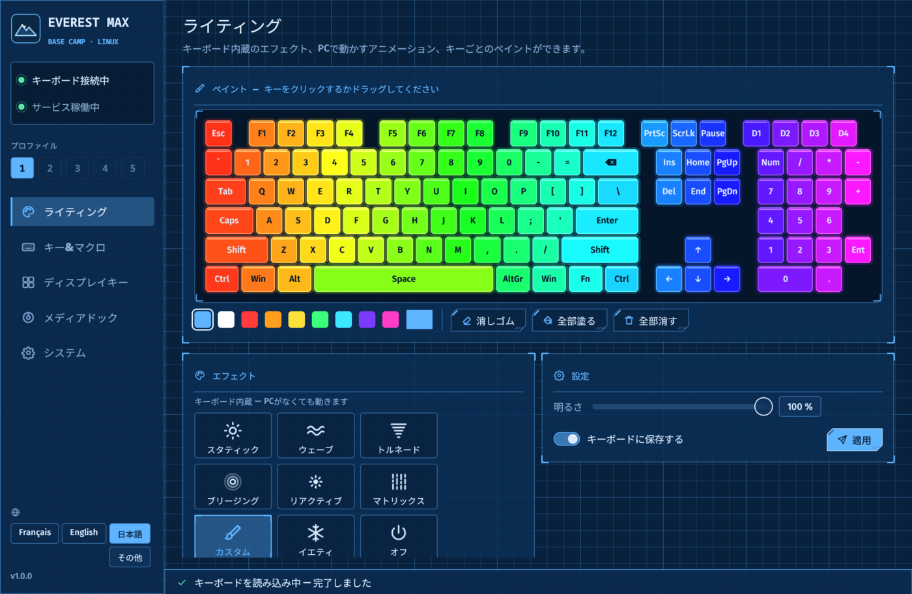
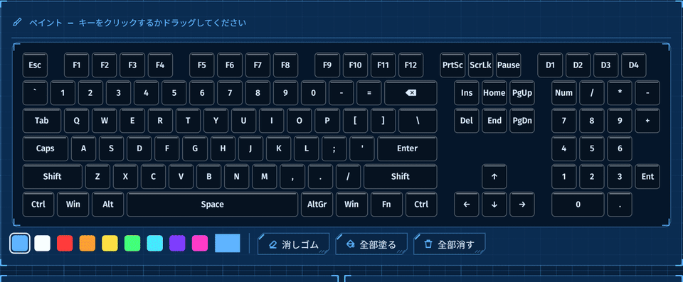
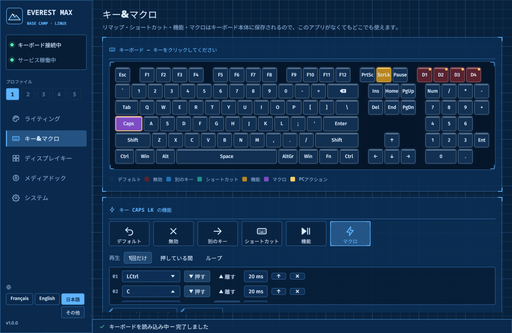
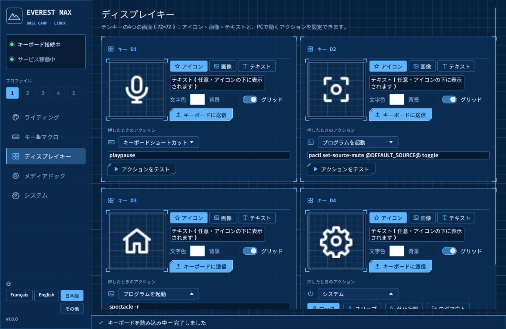
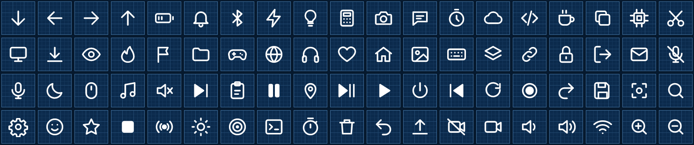
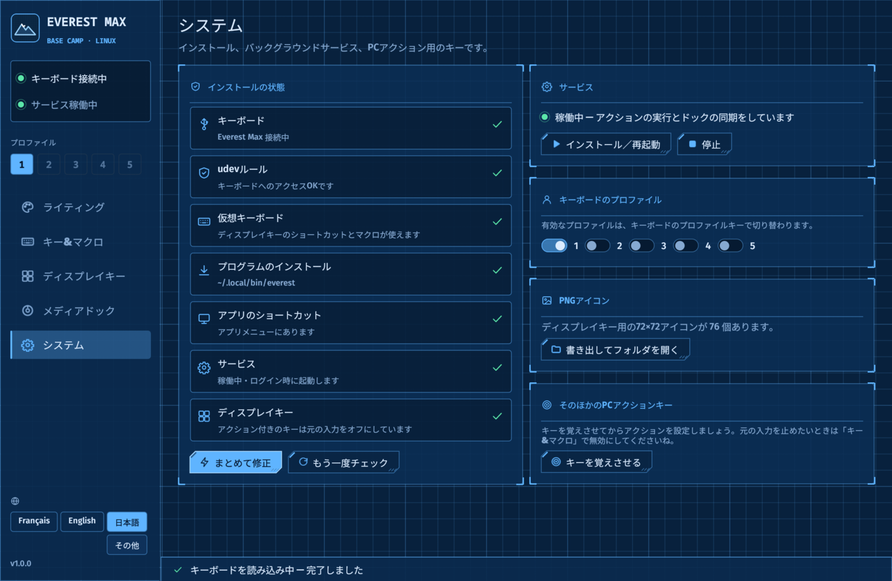

<div align="center">


# Everest Max Linux

Mountain Everest Max を Linux で設定するためのアプリです。

[English](README.md) · [Français](README.fr.md) · **日本語**

[](LICENSE)

</div>

Everest Max の設定ソフト Base Camp は Windows 版しかありません。僕は Linux でこのキーボードを使っているので、Base Camp とキーボードのやり取りを調べて、同じことができる Linux アプリを Rust で作りました。Base Camp にない機能もいくつか足してあります。

個人で作っている非公式のプロジェクトで、Mountain とは関係ありません。自分の Everest Max では問題なく動いていますが、利用は自己責任でお願いします。


## インストール

1. [最新リリース](https://github.com/AnnoyedDev/everest-max-linux/releases/latest)から `.tar.gz` をダウンロードして展開します（x86_64 用）。
2. `./everest` を実行します。
3. 最初の画面で**まとめてセットアップ**を押します。キーボードにアクセスするための udev ルールを入れるので、管理者パスワードを一度だけ聞かれます。

これでアプリメニューに **Everest Base Camp** が追加され、サービスはログイン時に自動で起動します。新しいバージョンが出たときはアプリが知らせます。

自分でビルドする場合は Rust（`cargo`）を使います。

```sh
git clone https://github.com/AnnoyedDev/everest-max-linux
cd everest-max-linux/rust
cargo build --release
./target/release/everest
```

ほかに必要なものは、たいていのディストリビューションに最初から入っています。PipeWire か PulseAudio（`pactl`、`parec`、`paplay`）、`fontconfig`、`zenity` か `kdialog`、`pkexec`、systemd です。日本語の表示には Noto Sans CJK などの CJK フォントを入れてください。

パッケージ用には、AUR の `PKGBUILD` が [`packaging/aur`](packaging/aur) にあります。`rust/` では `cargo deb` と `cargo generate-rpm` が使え、[`packaging/appimage.sh`](packaging/appimage.sh) で AppImage を作れます。

## 各ページの使い方

### ライティング



1. エフェクトを選び、色（またはレインボー）、スピード、向きを決めます。
2. プレビューで動きを確認します。
3. **適用**を押します。「キーボードに保存する」をオンにすると、ケーブルを抜いても設定が残ります。

キーボード内蔵の 9 種類に加えて、PC 側で毎秒 30 コマほど描いて送るエフェクトが 12 種類あります。オーロラ、ファイア、レイン、音に反応する 2 種類（すべての音、特定の出力、マイクから選択）、CPU・GPU・RAM・ネットの負荷をキーに表示するメーターなどです。

**カスタム**を選ぶと、クリックかドラッグでキーを 1 つずつ塗れます。



### キー＆マクロ



1. 変えたいキーをクリックします。
2. 役割を選びます。別のキー、ショートカット、メディア・マウス・プロファイルの操作、マクロ、無効化から選べます。
3. **このキーを送信**を押します。

画像の例では、Caps Lock が Ctrl+C、Scroll Lock が音楽の一時停止になっています。マクロは 1 ステップずつ組むか、**リアルタイムで記録**を押して実際に打ち込みます（打ったタイミングも記録されます）。設定はキーボード本体に保存されるので、アプリを閉じていても使えます。

### ディスプレイキー



テンキーにある 4 つの小さな画面付きキー（D1〜D4）です。付属の 76 個のアイコン、自分の画像、テキスト（日本語も可）のどれかを選び、**キーボードに送信**を押すと表示されます。

押したときのアクションも付けられます。

- アプリを起動する、ウェブサイトを開く
- 好きな出力でサウンドを再生する（音量は 150 % まで）
- ショートカットやマクロを送る
- メディアプレーヤー（Spotify、VLC、ブラウザなど）を操作する
- OBS Studio を操作する（シーン、録画、配信、ミュート）
- 画面をロックする、PC をシャットダウンする

アクションを付けると、そのキーの元の入力は自動でオフになるので、押すたびに F13 が一緒に入力されることはありません。


アイコンは 72×72 の PNG として [`rust/assets/keys`](rust/assets/keys) にも入っています。



### メディアドック


丸い画面のモジュールです。時刻、システム音量、PC の情報（CPU、GPU、ディスク、ネット、RAM、1 分あたりの打鍵数）を表示できます。PC の情報はサービスが毎秒送っているので、サービスが止まっていると 0 のままです。ネットの 100 % は、ネットワークカードのリンク速度か、自分で決めた上限です。

自分の画像はスクリーンセーバーとしてだけ表示できます。タイプを「画像」にして、開始までの時間を決め、適用してください。

### システム



インストールとサービスの状態を確認し、5 つのプロファイルを管理するページです。プロファイルはそれぞれライティング、キー、ディスプレイキーの設定を別々に持ち、名前の変更、別のプロファイルへのコピー、ファイルへの書き出しと読み込みができます。プロファイル番号を右クリックすると、キーボード側での有効・無効を切り替えられます。

ほかのキーをアプリに「覚えさせて」、PC のアクションを割り当てることもできます。

## そのほかの機能

| 機能 | 説明 |
| --- | --- |
| MacroPad / DisplayPad | 12 個のキーそれぞれにアクションを設定できます。MacroPad はライティング（内蔵エフェクト、リアクティブ B / C、キーごとの色）、DisplayPad は各キーへのアイコン・画像・テキストの表示に対応しています。どちらも持っていないので実機では未確認です。動作報告を歓迎します。 |
| ソフトウェア Fn | 好きなキーを「Fn」に指定すると、押しているあいだ、覚えさせたキーが 2 つ目のアクションを実行します。 |
| 打鍵ヒートマップ | 初期状態ではオフです。保存するのはキーごとの回数だけで、PC の外には出ません。 |
| OpenRGB | 内蔵サーバーをオンにすると、OpenRGB からほかの機器と同じように操作できます。 |
| ロック中の消灯 | セッションをロックしているあいだ、ライトを消します。 |
| 色をそろえる | ワンクリックで、MacroPad とドックのメニューをキーボードと同じ色にします。 |
| 表示言語 | 日本語、英語、フランス語。 |

## コマンドライン

```
everest                  アプリを開く
everest setup            インストールをチェックして修復する
everest version          バージョンを表示する
everest clock            ドックの時刻を合わせる
everest image d1 lock    D1 に「lock」アイコンを表示する（ファイルやテキストも使えます）
everest export-icons     PNG アイコンを書き出す
```

## しくみ

Base Camp は `SDKDLL.dll` という DLL から、64 バイトのパケットをキーボードに送っています。この DLL を逆アセンブルしてコマンドをすべて書き出し、ひとつずつ実機で確かめました。記録は [PROTOCOL.en.md](PROTOCOL.en.md)（英語）と [PROTOCOL.md](PROTOCOL.md)（フランス語）にあります。

未対応の機能が 2 つあります。ファームウェアの更新は、手探りで試すには危険なので見送っています。キーボード本体の Fn レイヤーは、そのためのコマンドがないので、ソフトウェア Fn で代用しています。

## アンインストール

```sh
systemctl --user disable --now everest-basecamp
rm ~/.config/systemd/user/everest-basecamp.service ~/.local/bin/everest ~/.local/share/applications/everest-basecamp.desktop
sudo rm /etc/udev/rules.d/70-mountain-everest.rules /etc/modules-load.d/everest-uinput.conf
sudo udevadm control --reload && sudo udevadm trigger
```

設定は `~/.config/everest-basecamp/` にあります。

## 協力してくれる方へ

バグやアイデアは Issue に書いてください。何をして、どうなったかがあると助かります。翻訳の修正や追加も歓迎です。テキストはすべて [`rust/data/i18n.tsv`](rust/data/i18n.tsv) に 1 行ずつ入っているので、不自然な訳を直すか、新しい言語の列を足してください。

## ライセンス

[MIT ライセンス](LICENSE)です。コード、アイコン、画像のどれも、商用を含めて再利用、改変、販売、自分のプロジェクトへの組み込みができます。条件は「Copyright (c) 2026 AnnoyedDev」の表記とライセンス文を残すことだけです。
