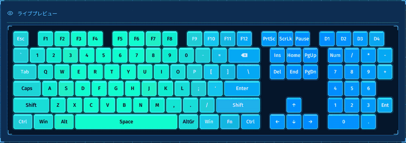
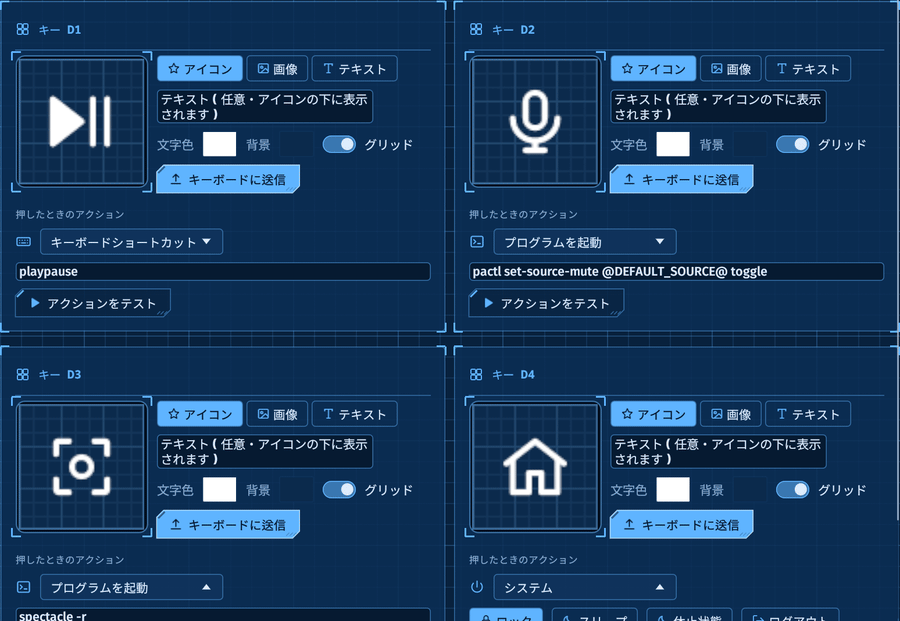
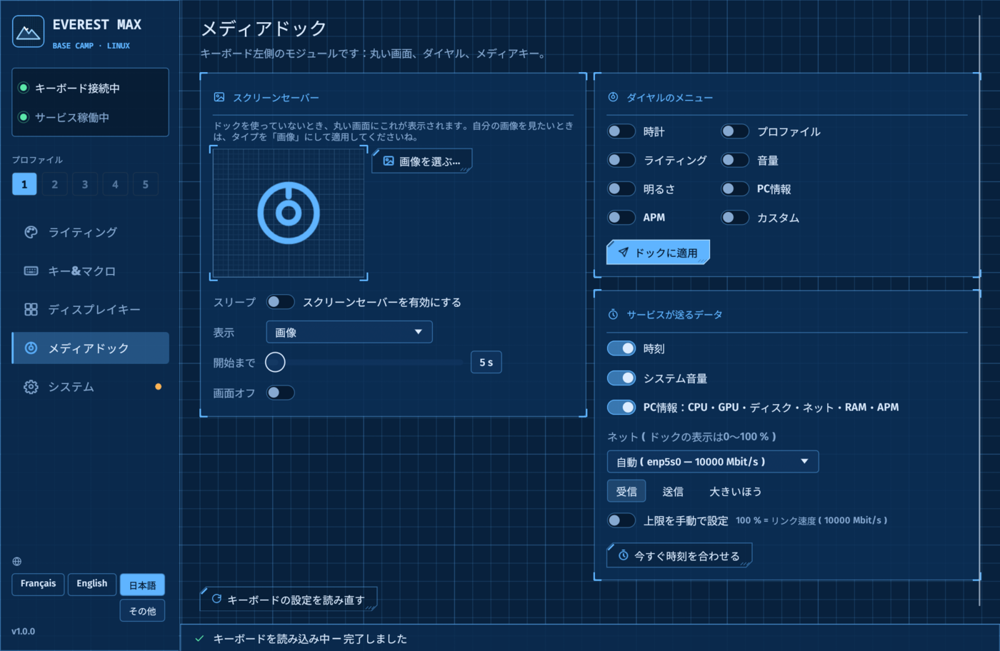

<div align="center">


# Everest Max Linux

**Mountain Everest Max のための、Linux 版 Base Camp です。**

[English](README.md) · [Français](README.fr.md) · **日本語**

[](LICENSE)

</div>

---

Everest Max を Linux で使おうとしたら、Base Camp が Windows 専用だった…という経験、ありませんか？僕もそうでした。そこで Base Camp がキーボードとどうやって通信しているのかを調べて、Rust で Linux ネイティブのアプリとして作り直しました。Base Camp でできることはひと通りできて、おまけの機能もいくつか付いています。

> 個人で作っている**非公式**のプロジェクトで、Mountain とは関係ありません。実機の Everest Max で動作を確認していますが、使うときは自己責任でお願いしますね。



## できること

- **ライティング**：キーボード内蔵の 9 種類のエフェクト（ウェーブ、トルネード、ブリージング、リアクティブ、マトリックス、イエティなど）を、カラー・スピード・向き・レインボーまで設定できます。送信する前にアニメーションでプレビューも確認できます。
- **PC で動かす 12 種類の追加エフェクト**：オーロラ、ファイア、レイン、スター、グラデーション、オーディオスペクトラム、オーディオパルス、それから CPU・GPU・RAM・ネットの負荷をキーの上にメーター表示するものもあります。
- **キーごとのペイント**：マウスでクリックしたりドラッグしたりして、キーボードに直接色を塗れます。
- **キー＆マクロ**：好きなキーをリマップしたり、無効にしたり、ショートカットやメディア・マウス・プロファイルの機能、マクロを割り当てられます。設定はキーボード本体に保存されるので、アプリを閉じていても使えます。
- **テンキーの 4 つのディスプレイキー（D1〜D4）**：アイコン（76 個入り）、好きな画像、テキストを表示できて、押したときのアクションも設定できます。アプリの起動、サイトを開く、好きな出力でサウンド再生（音量は 150 % まで）、ショートカット、マクロ、ロック、シャットダウンなど。
- **メディアドック**（丸い画面のモジュール）：自分の画像をスクリーンセーバーにしたり、時刻やシステム音量を表示したり。PC 情報（CPU・GPU・ディスク・ネット・RAM・1 分あたりの打鍵数）も、ちゃんと数字が出るようになりました。
- **MacroPad と DisplayPad**：12 個のキーそれぞれにアクションを割り当てられます。MacroPad はライティング（内蔵エフェクトとキーごとの色）、DisplayPad は各キーにアイコン・画像・テキストを表示できます。まだ実機では試せていないので（どちらも持っていなくて…）、使ってみた感想を教えてもらえるとうれしいです。
- **プロファイル**：キーボードのプロファイルを有効・無効にできます（番号を右クリック）。
- **セットアップのガイド付き**：初回起動時に、足りないもの（udev ルール、サービス、アプリメニューのショートカットなど）をチェックして用意してくれます。アップデートがあるときも教えてくれますよ。
- **3 か国語対応**：日本語、英語、フランス語。

## スクリーンショット

### ライティング


エフェクトを選んで、調整して、プレビューを見て、**適用**を押すだけです。「キーボードに保存する」をオンにしておけば、ケーブルを抜いても設定が残ります。

キーごとに塗りたいときは**カスタム**を選んでくださいね。


「PC で動かすエフェクト」は、バックグラウンドのサービスが毎秒 30 コマくらいで描いています。オーディオ系のエフェクトでは、聴く音を「すべての音」「特定の出力」「マイク」から選べます。

### キー＆マクロ


キーをクリックして、割り当てたい機能を選んで、**このキーを送信**を押します。この例では、Caps Lock で Ctrl+C、Scroll Lock で音楽の一時停止をしています。

### ディスプレイキー


ライブラリからアイコンを選ぶか、自分の画像を使うか、テキストを入力して（日本語も大丈夫です）、**キーボードに送信**を押します。アクションを設定すると、そのキーの元の入力は自動でオフになるので、押すたびに F13 が一緒に入力されることもありません。



76 個のアイコンは、[`rust/assets/keys`](rust/assets/keys) に 72×72 の PNG としても入っています。ほかのことにも自由に使ってくださいね。


### メディアドック



ドックに自分の画像を表示できるのは**スクリーンセーバー**のときだけです。タイプを「画像」にして、開始までの時間を決めて、適用してください。PC 情報の数字はサービスが毎秒送っているので、サービスが止まっていると全部 0 のままになります。ネットは、ネットワークカードのリンク速度（または自分で決めた上限）を 100 % として表示します。

### システム


インストールの状態、サービス、プロファイルの管理に加えて、ほかのキーを「覚えさせて」PC アクションを割り当てることもできます。

## インストール

Rust（`cargo`）が必要です。ほかのものはたいていのディストリビューションに最初から入っています：PipeWire か PulseAudio（`pactl`、`parec`、`paplay`）、`fontconfig`、ファイル選択用の `zenity` か `kdialog`、`pkexec`、systemd。日本語を表示するには、Noto Sans CJK などの CJK フォントを入れておいてくださいね。

```sh
git clone https://github.com/AnnoyedDev/everest-max-linux
cd everest-max-linux/rust
cargo build --release
./target/release/everest
```

初回起動のときに**まとめてセットアップ**を押してください。キーボードにアクセスするための udev ルールのために、管理者パスワードを一度だけ聞かれます。そのあとはアプリメニューに **Everest Base Camp** が入って、サービスもログイン時に自動で起動します。

### コマンドライン

```
everest                  アプリを開く
everest setup            インストールをチェックして修復する
everest version          バージョンを表示する
everest clock            ドックの時刻を合わせる
everest image d1 lock    D1 に「lock」アイコンを表示する（ファイルやテキストも使えます）
everest export-icons     PNG アイコンを書き出す
```

## しくみ

Base Camp は `SDKDLL.dll` という DLL を通して、キーボードに 64 バイトのパケットを送っています。これを逆アセンブルして、コマンドをひとつずつ書き出し、実機で確かめました。詳しい内容は [PROTOCOL.md](PROTOCOL.md) にまとめてあります（今のところフランス語のみです）。

## アンインストール

```sh
systemctl --user disable --now everest-basecamp
rm ~/.config/systemd/user/everest-basecamp.service ~/.local/bin/everest ~/.local/share/applications/everest-basecamp.desktop
sudo rm /etc/udev/rules.d/70-mountain-everest.rules /etc/modules-load.d/everest-uinput.conf
sudo udevadm control --reload && sudo udevadm trigger
```

設定は `~/.config/everest-basecamp/` に保存されています。

## 手伝ってもらえたらうれしいです

- **翻訳**：テキストはすべて [`rust/data/i18n.tsv`](rust/data/i18n.tsv) に、1 行ずつ（フランス語・英語・日本語）入っています。新しい言語の列を足したり、不自然なところを直したりしてもらえると助かります。
- **バグやアイデア**：Issue を立てて、何をしたらどうなったかを書いてくださいね。

まだできていないこと：ファームウェアのアップデート（手探りでやるには危ないので）と Fn レイヤー（キーボード側にそのためのコマンドがありません）。

## ライセンス

[MIT ライセンス](LICENSE)です。再利用も改変も販売も、自分のプロジェクトに組み込むのも、商用でも自由にどうぞ。条件はひとつだけで、「Copyright (c) 2026 AnnoyedDev」の表記とライセンス文を残しておいてくださいね。コード・アイコン・画像、全部同じです。
