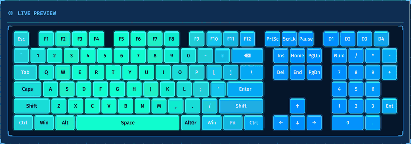
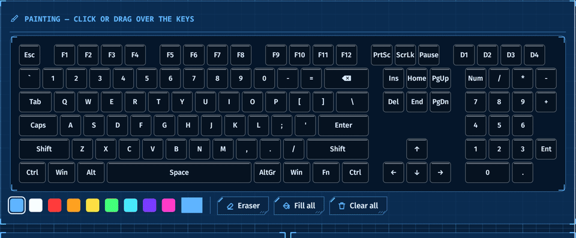
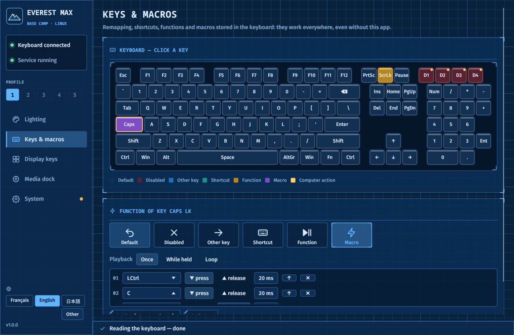
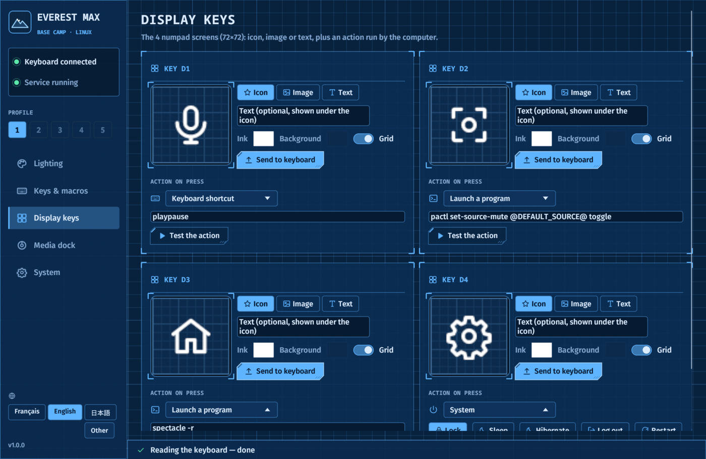
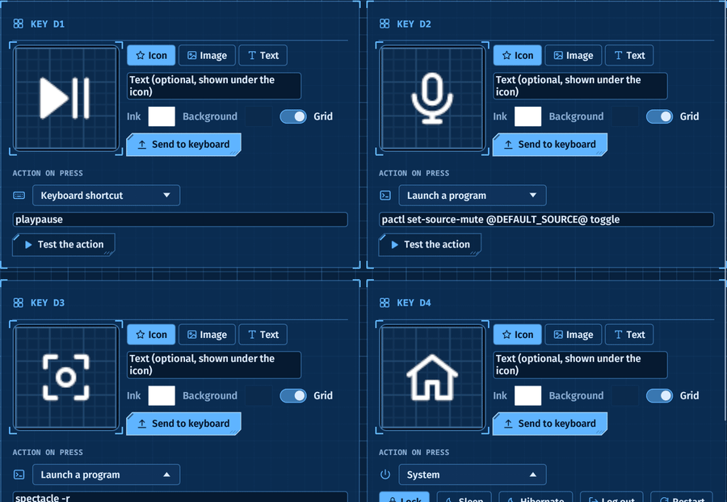
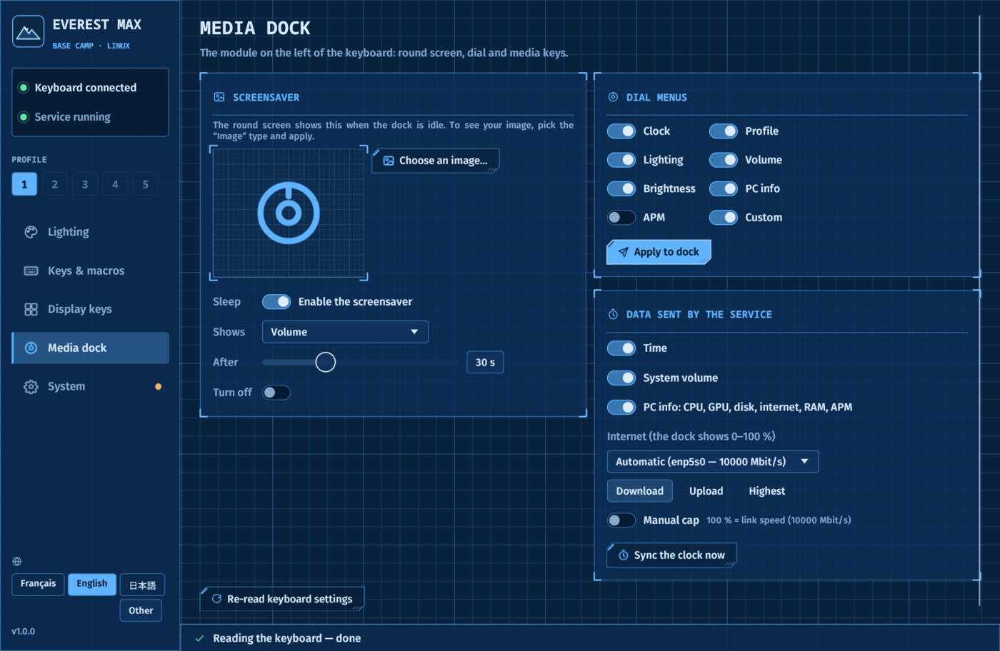
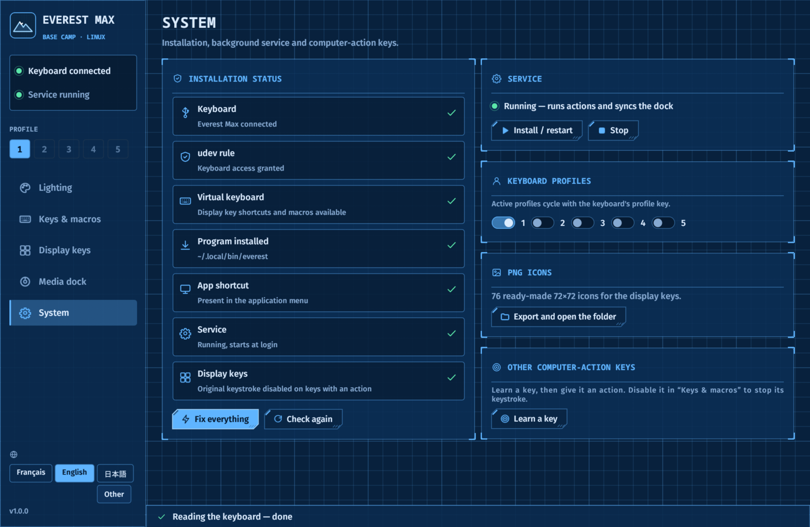

<div align="center">


# Everest Max Linux

**The Base Camp app Linux never got, for the Mountain Everest Max keyboard.**

**English** · [Français](README.fr.md) · [日本語](README.ja.md)

[](LICENSE)

</div>

---

Got an Everest Max, switched to Linux, then found out Base Camp is Windows-only? Same here. So I took Base Camp apart, figured out exactly how it talks to the keyboard, and rebuilt it as a native Linux app in Rust. It does what Base Camp does, plus a few extras.

> This is a personal, **unofficial** project with no connection to Mountain. It runs fine on my own Everest Max, but use it at your own risk.



## What it does

- **Lighting**: all 9 built-in effects (Wave, Tornado, Breathing, Reactive, Matrix, Yeti…) with colors, speed, direction and rainbow mode, plus a live animated preview before you send anything.
- **12 extra effects driven by your PC**: Aurora, Fire, Rain, Stars, Gradient, Audio spectrum, Audio pulse, and CPU / GPU / RAM / internet load bars right on your keys.
- **Per-key painting**: click or drag across the keyboard to paint it.
- **Keys & macros**: remap any key, turn it off, give it a shortcut, a media / mouse / profile function, or a macro. It's all saved on the keyboard, so it keeps working without the app.
- **The 4 display keys on the numpad (D1–D4)**: an icon (76 included), your own picture or some text, plus an action when you press it: launch an app, open a website, play a sound on any output (volume up to 150 %), a shortcut, a macro, lock, shut down…
- **Media dock** (the bit with the round screen): your picture as a screensaver, the clock, system volume, and the PC info screens (CPU, GPU, disk, internet, RAM, keys per minute) finally showing real numbers.
- **MacroPad & DisplayPad**: the 12 keys of each pad get an action, the MacroPad gets its lighting (built-in effects and per-key colors), and the DisplayPad gets an icon, picture or text on every key. Untested on real hardware for now (I don't own either pad), so feedback is very welcome.
- **Profiles**: turn the keyboard's profiles on or off (right-click a profile number).
- **Guided setup**: on first launch the app checks what's missing (udev rule, background service, menu entry…) and sorts it out. It also tells you when there's an update to install.
- **3 languages**: English, French and Japanese.

## Screenshots

### Lighting


Pick an effect, tweak it, check the preview and hit **Apply**. Turn on "Save to the keyboard" and it'll remember the effect even after you unplug it.

Want to paint key by key? Pick the **Custom** effect:



The "animated by the computer" effects are rendered by the background service at about 30 fps. For the audio ones you choose what to listen to: everything, one specific output, or your mic.

### Keys & macros



Click a key, pick what it should do, then **Send this key**. In this example Caps Lock does Ctrl+C and Scroll Lock pauses the music.

### Display keys



Grab an icon from the library, use your own picture, or type some text (Japanese works too), then **Send to keyboard**. Once a key has an action, the app switches off its original keystroke automatically, so you don't get a stray F13 every time you press it.



All 76 icons are also available as 72×72 PNGs in [`rust/assets/keys`](rust/assets/keys) if you want them for something else:


### Media dock



The dock only shows your picture as a **screensaver**: set the type to "Image", choose the delay, and apply. The PC info numbers come from the service, which sends them every second (without it everything stays at 0). For internet, 100 % means your network card's link speed, or a cap you set yourself.

### System



Install status, the background service, profiles, and a way to "learn" any other key and give it a PC action.

## Install

You'll need Rust (`cargo`). Most distros already ship the rest: PipeWire or PulseAudio (`pactl`, `parec`, `paplay`), `fontconfig`, `zenity` or `kdialog` for file pickers, `pkexec` and systemd. For Japanese you'll want a CJK font such as Noto Sans CJK.

```sh
git clone https://github.com/AnnoyedDev/everest-max-linux
cd everest-max-linux/rust
cargo build --release
./target/release/everest
```

On first launch, click **Set everything up**. It asks for your admin password once, for the udev rule that lets you talk to the keyboard. After that you'll find **Everest Base Camp** in your app menu, and the service starts on its own when you log in.

### Command line

```
everest                  open the app
everest setup            check and fix the install
everest version          print the version
everest clock            sync the dock's clock
everest image d1 lock    put the "lock" icon on D1 (also takes a file or some text)
everest export-icons     export the PNG icons
```

## How it works

Base Camp goes through a DLL (`SDKDLL.dll`) that sends the keyboard 64-byte packets. I disassembled it, wrote down every command and tested each one on the real keyboard. Everything is explained in [PROTOCOL.md](PROTOCOL.md) (French only for now).

## Uninstall

```sh
systemctl --user disable --now everest-basecamp
rm ~/.config/systemd/user/everest-basecamp.service ~/.local/bin/everest ~/.local/share/applications/everest-basecamp.desktop
sudo rm /etc/udev/rules.d/70-mountain-everest.rules /etc/modules-load.d/everest-uinput.conf
sudo udevadm control --reload && sudo udevadm trigger
```

Your settings live in `~/.config/everest-basecamp/`.

## Want to help?

- **Translations**: every string is in [`rust/data/i18n.tsv`](rust/data/i18n.tsv), one line per text (French, English, Japanese). Add a column, or fix anything that reads oddly.
- **Bugs and ideas**: open an issue and say what you did and what happened.

Not done yet: firmware updates (too risky to do blind) and the Fn layer (the keyboard doesn't expose a command for it).

## License

[MIT](LICENSE): reuse it, change it, sell it, drop it into your own project, commercial or not. The one condition is that you keep the "Copyright (c) 2026 AnnoyedDev" notice and the license text. That goes for the code, the icons and the images.
