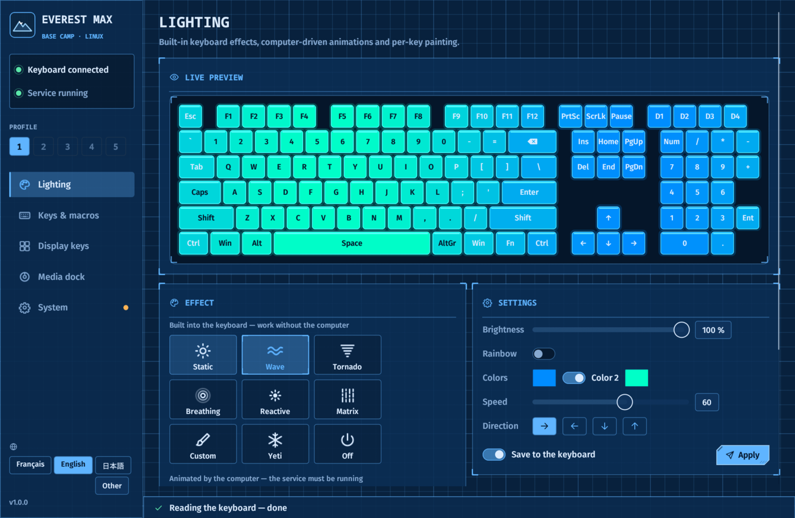
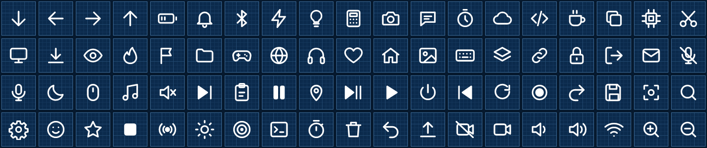

<div align="center">


# Everest Max Linux

Base Camp for the Mountain Everest Max keyboard, rebuilt for Linux.

**English** · [Français](README.fr.md) · [日本語](README.ja.md)

[](LICENSE)

</div>

Mountain only makes Base Camp for Windows. I own an Everest Max and use Linux, so I worked out how Base Camp talks to the keyboard and rewrote it as a Linux app in Rust, with a few extras.

This is an unofficial personal project with no connection to Mountain. It works on my own Everest Max, but you use it at your own risk.


## Install

Download the `.tar.gz` from the [latest release](https://github.com/AnnoyedDev/everest-max-linux/releases/latest) (64-bit Intel or AMD), unpack it and run `./everest`. Or build it with Rust:

```sh
git clone https://github.com/AnnoyedDev/everest-max-linux
cd everest-max-linux/rust
cargo build --release
./target/release/everest
```

On first launch, click **Set everything up**. It asks for your admin password once, for the udev rule that gives access to the keyboard. **Everest Base Camp** then shows up in your app menu, its background service starts when you log in, and the app tells you when an update is out.

Most distros already ship what else it needs: PipeWire or PulseAudio (`pactl`, `parec`, `paplay`), `fontconfig`, `zenity` or `kdialog`, `pkexec` and systemd. Japanese text needs a CJK font such as Noto Sans CJK.

For packagers, there is an AUR `PKGBUILD` in [`packaging/aur`](packaging/aur), `cargo deb` and `cargo generate-rpm` work from `rust/`, and [`packaging/appimage.sh`](packaging/appimage.sh) builds an AppImage.

## A tour of the app

### Lighting



Pick an effect, set its colors (or rainbow), speed and direction, check the preview and click **Apply**. "Save to the keyboard" keeps the effect after you unplug it.

On top of the keyboard's 9 effects, the app has 12 that your PC animates at about 30 frames per second, such as Aurora, Fire, Rain, two that follow sound (everything you hear, one output or your microphone), and CPU, GPU, RAM or internet load bars on the keys.

The **Custom** effect lets you paint keys one by one, by clicking or dragging:


### Keys and macros


Click a key, choose what it does, then click **Send this key**. It can become another key, a shortcut, a media, mouse or profile control, a macro, or nothing at all. In the screenshot, Caps Lock sends Ctrl+C and Scroll Lock pauses the music.

Build a macro step by step, or use **Record live** and type it with your own timing. All of this is stored in the keyboard, so it works with the app closed.

### Display keys


The four small screens on the numpad (D1 to D4) each show one of 76 icons, your own picture or some text, Japanese included. **Send to keyboard** puts it on the key.

A press can open an app or a website, play a sound on the output you choose (up to 150 % volume), send a shortcut or a macro, control your media player (Spotify, VLC, a browser…) or OBS Studio (scenes, recording, streaming, mute), lock the session or shut the PC down. The app then turns off the key's original keystroke, so it doesn't also type F13.


The icons are also in [`rust/assets/keys`](rust/assets/keys) as 72×72 PNGs:



### Media dock


The module with the round screen shows the clock, the system volume and PC numbers: CPU, GPU, disk, internet, RAM and keys per minute. The background service sends them every second, so they read 0 while it is stopped. For internet, 100 % is your network card's link speed, or a cap you set.

Your own picture only shows as a screensaver: set the type to "Image", pick a delay and apply.

### System


This page shows the state of the install and of the background service, and holds the 5 profiles. Each profile keeps its own lighting, keys and display keys. You can name them, copy one onto another, and export or import them as a file. Right-click a profile number to turn it on or off on the keyboard.

You can also "teach" the app any other key and give it a PC action.

## Other things it does

- MacroPad and DisplayPad: an action on each of the 12 keys, MacroPad lighting (built-in effects, Reactive B and C included, and per-key colors), and an icon, picture or text on every DisplayPad key. I own neither, so this is untested on real hardware. Tell me how it goes.
- A software Fn key: choose any key as "Fn", and the keys you taught the app run a second action while you hold it.
- A keystroke heatmap, off by default. It stores one count per key, on your computer.
- An OpenRGB server you can turn on, so OpenRGB drives the keyboard like any other device.
- Lights off while your session is locked.
- One click to give the MacroPad and the dock menus the keyboard's colors.
- English, French and Japanese.

## Command line

```
everest                  open the app
everest setup            check and fix the install
everest version          print the version
everest clock            sync the dock's clock
everest image d1 lock    put the "lock" icon on D1 (also takes a file or some text)
everest export-icons     export the PNG icons
```

## How it works

Base Camp talks to the keyboard through a DLL (`SDKDLL.dll`) that sends 64-byte packets. I disassembled it, wrote down every command and tested each one on the real keyboard. The notes are in [PROTOCOL.en.md](PROTOCOL.en.md).

Two things are missing. Firmware updates are too risky to attempt blind, and the keyboard has no command for a real Fn layer, which is why the Fn key is done in software.

## Uninstall

```sh
systemctl --user disable --now everest-basecamp
rm ~/.config/systemd/user/everest-basecamp.service ~/.local/bin/everest ~/.local/share/applications/everest-basecamp.desktop
sudo rm /etc/udev/rules.d/70-mountain-everest.rules /etc/modules-load.d/everest-uinput.conf
sudo udevadm control --reload && sudo udevadm trigger
```

Your settings are in `~/.config/everest-basecamp/`.

## Helping out

Found a bug or have an idea? Open an issue and say what you did and what happened. For translations, every string is in [`rust/data/i18n.tsv`](rust/data/i18n.tsv), one line per text: add a column for a new language, or fix a line that reads oddly.

## License

[MIT](LICENSE). You can reuse, change and sell the code, the icons and the images, in commercial projects too, as long as you keep the "Copyright (c) 2026 AnnoyedDev" notice and the license text.
